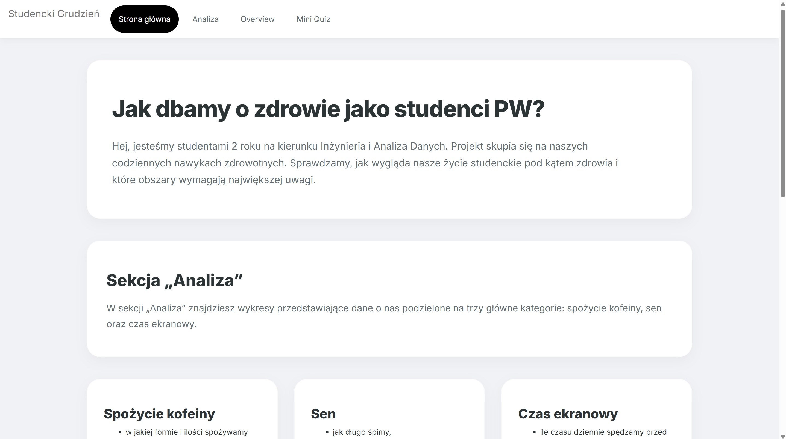
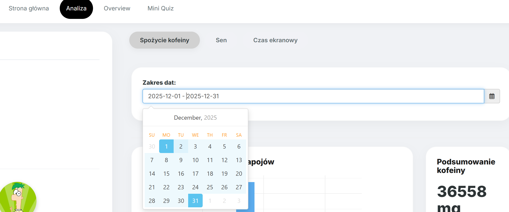
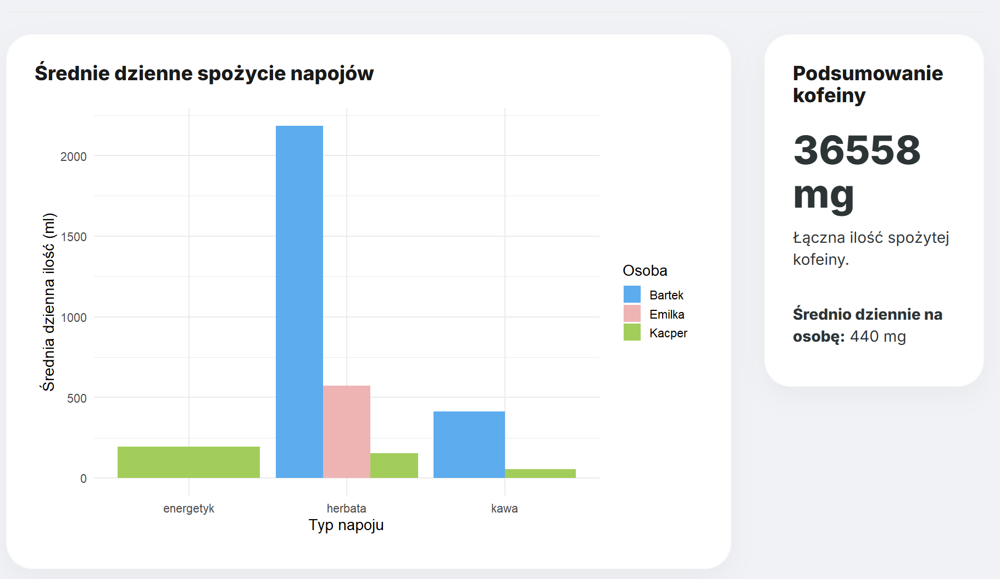
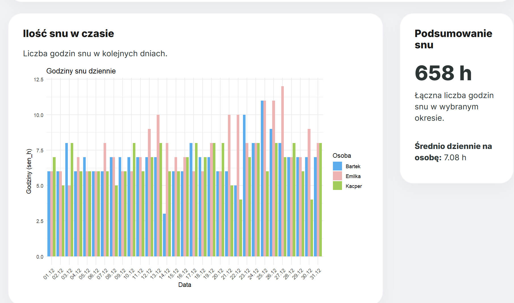
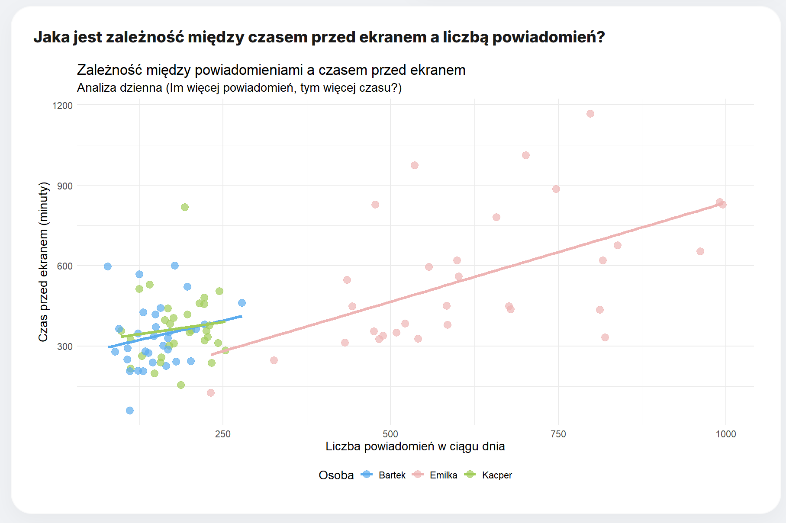
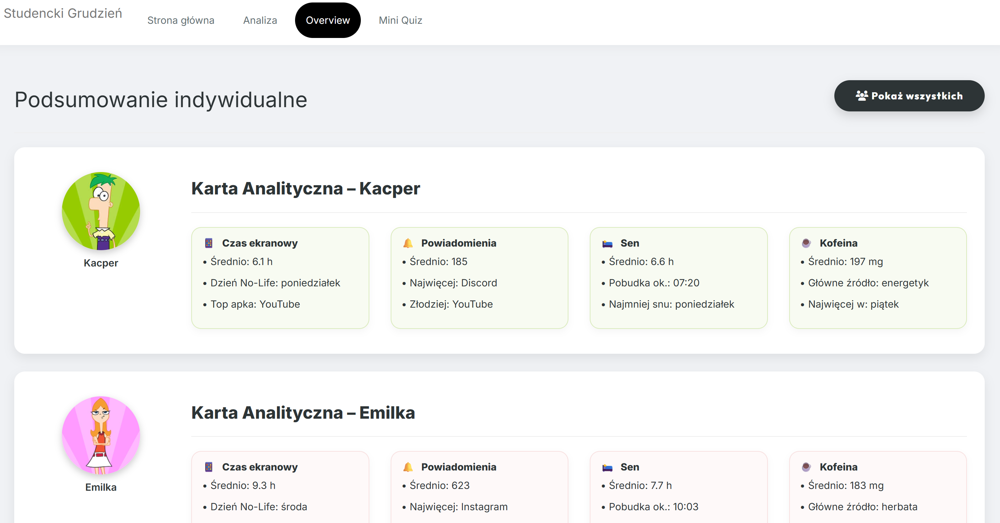
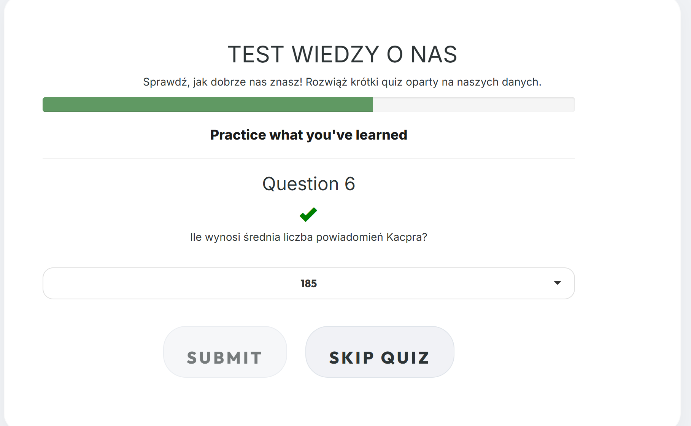

# Student December — A Student Lifestyle Dashboard

**An interactive R Shiny application exploring screen time, sleep, and caffeine consumption through a month of personal data.**

What does a month of student life look like when everyday habits become data? **Student December** (*Studencki Grudzień*) brings together records from three students throughout December 2025 and turns them into an interactive visual story. Users can compare participants, investigate individual days, explore weekly routines, and test what they have learned in a short quiz.

Developed as a team project for the **Data Visualization Techniques** course at **Warsaw University of Technology**, the application combines data preparation, exploratory analysis, reactive programming, and a custom dashboard interface.

The application interface and quiz are in **Polish**. This README provides an English guide to the project, its implementation, and how to run it locally.



## Project at a Glance

| Aspect | Details |
| --- | --- |
| Application | Interactive dashboard built with R and Shiny |
| Subject | Everyday habits of three students |
| Observation period | December 1–31, 2025 |
| Data | 1,765 application usage records, 93 sleep records, and 264 beverage records |
| Analytical areas | Screen time and notifications, sleep, caffeine consumption |
| Interaction | Participant selection, date ranges, adaptive charts, individual summaries, and a quiz |
| Interface | Custom CSS, card-based layouts, participant avatars, and consistent colors |
| Data source | CSV files included in the repository |

## Motivation and Analytical Questions

Everyday records become more useful when they can be compared across people, dates, and activities. The goal of this project was to make that exploration accessible through a visual application, without requiring users to inspect raw files or write R code.

The dashboard helps explore questions such as:

- How does daily screen time vary between participants and throughout the month?
- Which applications account for the most usage time and notifications?
- How does notification volume relate to time spent on a phone?
- How do sleep duration, bedtime, and wake-up time differ across participants?
- Which days of the week are associated with longer sleep or higher screen time?
- What types of caffeinated drinks do participants consume, and at what times?
- How does a selected day compare with a participant's monthly average?

The focus is **descriptive exploration and communication of patterns**. The application does not attempt to establish causal relationships between these habits.

## Features and Application Walkthrough

### 1. Home Page

The landing page introduces the project and its three analytical areas. It provides a direct route to the analysis section and clickable participant avatars that open individual overview cards.

### 2. Interactive Analysis

The **Analiza** section combines a shared participant filter with separate date-range controls for caffeine, sleep, and screen time. Users can compare all three participants, select a subset, or focus on one person.

Visualizations adapt to the selection. A multi-day view emphasizes patterns over time, while a single-day view exposes more detailed comparisons. Selecting one participant also changes the caffeine charts from comparisons between people to breakdowns by beverage variant.



#### Caffeine Consumption

This section combines beverage volume, estimated caffeine intake, and consumption timing:

- **Average daily beverage volume:** grouped bar charts compare drink categories across participants. For one participant, the breakdown shows beverage variants.
- **Consumption timing:** density plots show the distribution of recorded drinking times, grouped by participant or beverage variant.
- **Summary cards:** estimated caffeine totals, daily averages, and summaries of beverage choices across parts of the day.



#### Sleep

The sleep section presents both the amount of sleep and the timing of daily routines:

- **Daily sleep duration:** bar charts compare recorded hours of sleep.
- **Bedtime and wake-up distributions:** histograms show when participants tend to go to bed and get up.
- **Weekday patterns:** a radar chart compares average sleep duration across days of the week.
- **Single-day comparison:** the weekday view switches to a table comparing the selected day's sleep duration and sleep times with monthly averages.



#### Screen Time and Notifications

This section provides several complementary views of phone usage:

- **Daily trends:** line charts track screen time and notification counts over a date range.
- **Single-day application rankings:** selecting one day switches the corresponding charts to application-level bar charts showing the top 15 applications.
- **Word clouds:** application names are sized by total usage time or notification count.
- **Screen time versus notifications:** scatter plots compare daily totals with fitted trend lines; the single-day view compares individual applications.
- **Usage-to-notification ranking:** horizontal bars highlight applications with high usage relative to notification volume.
- **Weekday patterns:** a radar chart summarizes average screen time by weekday; for a single day, a table compares usage with monthly averages.



### 3. Individual Overview

The **Overview** page brings the three data domains together in participant-specific cards. These summarize metrics such as average daily screen time, notifications, sleep duration, wake-up time, and estimated caffeine intake, alongside application rankings and weekday highlights.

Overview cards use the full dataset, independently of the date filters in the analysis tabs. Users can open one participant's card from the home page or display all participants together.



### 4. Mini Quiz

The **Mini Quiz** turns exploration into a short knowledge check about the participants and their habits. It uses `shinyquiz` with a predefined question bank, feedback messages, and the option to skip questions.

Eight questions are randomly selected when the application initializes. The questions and correct answers are maintained in the repository rather than generated from the currently selected filters.



## Technical Highlights

The project demonstrates several practical aspects of building a data application:

- **Preparing heterogeneous records:** separate loaders parse three CSV schemas, normalize selected fields, convert date and time values, and derive analytical variables.
- **Reactive filtering:** Shiny reactive expressions supply filtered datasets to charts and summaries as users change participants or date ranges.
- **Choosing representations for the task:** trends, rankings, distributions, relationships, and weekly patterns use different chart types rather than relying on a single visualization format.
- **Adapting the level of detail:** conditional rendering changes views according to the number of selected people or dates.
- **Separating responsibilities:** data loading, chart functions, UI layout, server behavior, shared helpers, and quiz content live in separate files.
- **Presenting analysis clearly:** custom CSS, consistent participant colors, summary cards, and navigation connect the individual charts into a coherent application.

## Technology Stack

| Technology | Role in the project |
| --- | --- |
| **R** | Data preparation, calculations, and application logic |
| **Shiny** | Web interface, reactive data flow, and server-side rendering |
| **ggplot2** | Bar charts, time series, histograms, density plots, and scatter plots |
| **dplyr**, **tidyr**, **tibble** | Grouping, aggregation, reshaping, and tabular transformations |
| **lubridate** | Date handling and weekday extraction |
| **forcats** | Ordering categories for visualizations |
| **shinyWidgets** | Calendar-based date-range controls |
| **wordcloud** | Application usage and notification word clouds |
| **fmsb** | Radar charts for weekday comparisons |
| **RColorBrewer**, **viridis**, **scales** | Color palettes, transparency, and axis formatting |
| **shinyquiz** | Quiz questions, interaction, and feedback |
| **CSS** | Dashboard cards, typography, filters, and visual styling |

## Dataset

The repository includes all three input datasets, covering **three participants over 31 days**. No external data service or database is required.

| File | Rows | Record type | Main fields |
| --- | ---: | --- | --- |
| `data/aplikacje.csv` | 1,765 | Application usage for a participant and date | Participant, date, weekday, application, usage in minutes, notification count |
| `data/sen.csv` | 93 | Daily sleep record for a participant | Participant, date, sleep duration in hours, bedtime, wake-up time |
| `data/kofeina.csv` | 264 | Recorded beverage consumption | Participant, date, time, beverage category, variant, volume in milliliters |

The files use **UTF-8 encoding**, **semicolon delimiters**, and Polish column names. Dates are parsed in day–month–year order using `%d.%m.%Y`.

The loader converts application usage into numeric minutes, derives bedtime and wake-up values in minutes and decimal hours, and estimates caffeine intake from beverage volume and category. Sleep duration is read from the supplied `sen_h` field rather than recalculated from bedtime and wake-up time.

### Calculation Assumptions

**Estimated caffeine intake** uses the following fixed values defined in `R/data_load.R`:

| Beverage category | Assumed caffeine per 100 ml |
| --- | ---: |
| Coffee (`kawa`) | 40 mg |
| Tea (`herbata`) | 32 mg |
| Energy drink (`energetyk`) | 32 mg |

```text
estimated caffeine (mg) = beverage volume (ml) / 100 × category coefficient
```

These are simplified project assumptions. The calculation does not distinguish actual caffeine concentrations between brands, brewing methods, or individual beverage variants. The timing density plots use the hour component of each record, without minute-level precision, and describe the distribution of drinking events rather than caffeine dose over time.

The **usage-to-notification ranking** uses:

```text
usage ratio = total application time (minutes) / (total notifications + 1)
```

Adding one prevents division by zero. The chart includes applications with more than five minutes of recorded usage and selects the highest-ranking applications per participant. This is an exploratory usage metric, not a validated measure of engagement.

Daily averages also depend on the view: beverage-volume charts divide by the calendar span between the earliest and latest filtered records, while caffeine summary cards average the recorded participant-day totals. Missing records therefore should not automatically be interpreted as zero consumption.


## Authors

Created by students of **Data Engineering and Analysis at Warsaw University of Technology**:

- **Emilia Olszewska**
- **Kacper Piotrowski**
- **Bartosz Ponieważ**

Developed for the **Data Visualization Techniques** course under the project theme **“Me”**, using the team's everyday habits as the subject of analysis.
